


 

&nbsp;&nbsp;
&nbsp;&nbsp;
&nbsp;&nbsp;

 


 


 


 


<table>
<tr>
<td width="50%" align="center" valign="top">
 
<a href="https://smart-attendance-cquj.onrender.com/">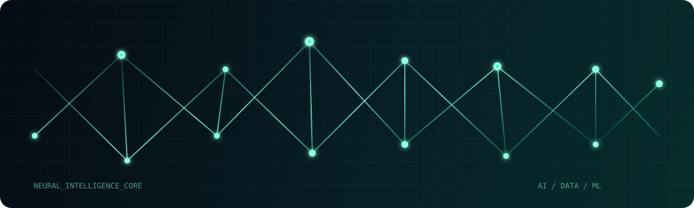</a>
<h3>Automatic Student Smart Attendance Using Computer Vision</h3>
Python · OpenCV · Haar Cascade · Face Recognition · SQLite · REST API

An intelligent computer-vision-based attendance management system automating student attendance tracking via face identification connected with structured web attendance records.

<a href="https://smart-attendance-cquj.onrender.com/"><b>🔗 Live Demo</b></a>
  
</td>
<td width="50%" align="center" valign="top">
 

<h3>Madurai College AI</h3>
Python · AI Assistant · NLP Foundations · Grounded Knowledge Base

An AI-powered information assistant designed around localized college information using a grounded domain knowledge base for contextual question answering.

<b>💡 Academic &amp; Localized AI System</b>
  
</td>
</tr>
</table>

 


<table>
<tr>
<td width="33%" align="center" valign="top">
 
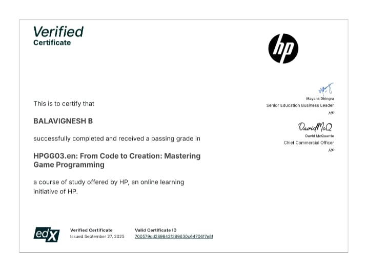 
<b>Mastering Game Programming</b> HP / edX · 2024
  
</td>
<td width="33%" align="center" valign="top">
 
 
<b>Python Training Program</b> Besant Technologies · 2024
  
</td>
<td width="33%" align="center" valign="top">
 
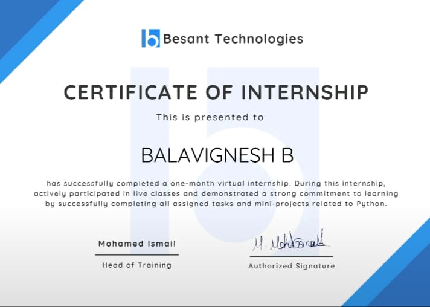 
<b>Certificate of Internship</b> Besant Technologies · 2024
  
</td>
</tr>
<tr>
<td width="33%" align="center" valign="top">
 
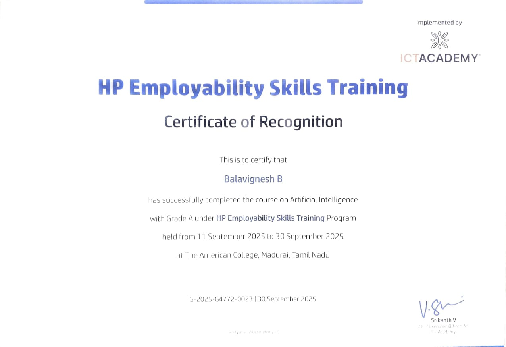 
<b>HP Employability Skills Training (AI)</b> HP · 2024
  
</td>
<td width="33%" align="center" valign="top">
 
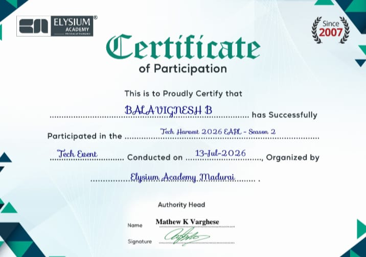 
<b>Tech Harvest 2026 — EAPL S2</b> Elysium Academy · 2024
  
</td>
<td width="33%" align="center" valign="top">
 
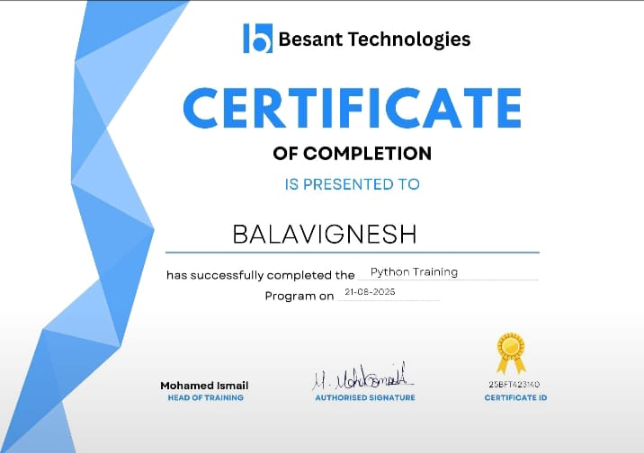 
<b>AI &amp; Data Science Program</b> Elysium Academy · 2024
  
</td>
</tr>
</table>

 


 
&nbsp;&nbsp;

 


 
&nbsp;&nbsp;
&nbsp;&nbsp;

 

